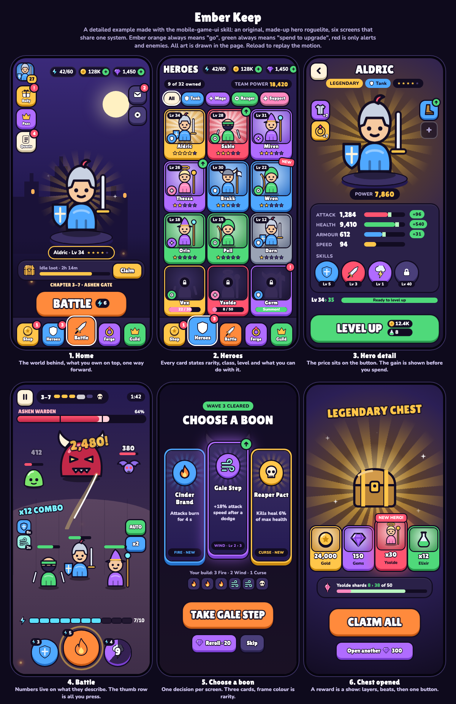
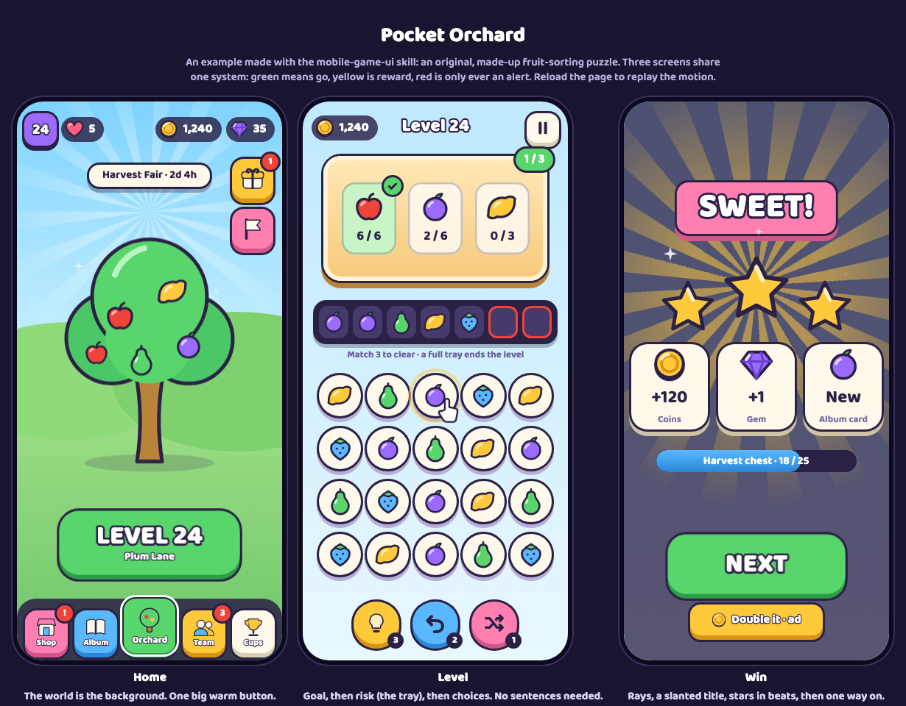

# mobile-game-ui: a Claude skill for designing mobile game UI

A skill for [Claude Code](https://claude.com/claude-code) that teaches Claude to design mobile game
interfaces the way top-grossing games do, mock them up, and build them in Unity.

It covers layout, visual systems, icons, animation and VFX, the reasons the patterns work, and a
1:1 route from an HTML mockup to Unity UI.

## Examples

Both are made-up games designed with this skill. Everything is drawn in the page (no image files),
and the motion is built in: open the HTML in a browser to see it move.

### Ember Keep: a detailed example (six screens)



`examples/ember-keep.html` is a hero roguelite: home, hero collection, hero detail, battle HUD, a
pick-one-of-three upgrade and a chest opening. It shows one system held across six screens:

- **Colour roles that never change:** ember orange is "go", green is "spend to upgrade", gold is
  reward, violet is premium, red is only alerts and enemies.
- **A rarity ladder** carried by frame colour on cards, gear, boons and rewards.
- **One icon family:** currencies and items as small rendered objects, system and class marks as
  flat glyphs, all with one outline and one light direction.
- **States:** owned, locked with progress, ready to summon, can upgrade, new, selected, on
  cooldown, affordable.
- **Numbers where they act:** costs on buttons, health over units, stat gains beside the stat.
- **Motion with a job:** staggered arrivals, a breathing primary button, rays behind prizes,
  rewards stamping in one beat at a time.

### Pocket Orchard: a small example (three screens)



`examples/pocket-orchard.html` is a calm fruit-sorting puzzle: home, level and win. It shows the
light end of the scale: three header items, a goal picture, a holding tray, one row of helpers.

## Install

Copy the `mobile-game-ui` folder into your Claude skills folder:

```bash
git clone <this repo's URL> && cp -R <repo folder>/mobile-game-ui ~/.claude/skills/
```

Start a new Claude Code session. Claude loads the skill by itself when you ask for game UI work.
You can also call it directly with `/mobile-game-ui`.

To use it in one project only, put the folder in that project's `.claude/skills/` instead.

## What you can ask

- "Design the home screen and battle HUD for my lane battler, as an HTML mockup."
- "Redesign this talent screen, it looks like an app, not a game."
- "Design the currency and item icons as one set."
- "Spec the chest-opening animation with timings."
- "Why do most puzzle games put boosters at the bottom?"
- "Turn this mockup into Unity UI."

## What is inside

| File | What it holds |
|------|---------------|
| `SKILL.md` | The workflow and 18 rules that held across the games studied |
| `references/layout-patterns.md` | Wireframes: home, map, HUDs by genre, results, collection, shop, popups, skill tree, and the templates newer hits share |
| `references/visual-design.md` | Colour roles, shape, type, style families, a mockup recipe, common failures |
| `references/icons.md` | App icon and in-game icon sets: families, anatomy, conventions, badges, sizes, tests |
| `references/motion-and-vfx.md` | Timing table, recipes per moment, a VFX kit, layering a reward, sound, restraint |
| `references/why-it-works.md` | The hand, the eye, habit, motivation, mood and audience, honest use |
| `references/top-games.md` | Notes on 151 top mobile games, grouped by genre and by shared template |
| `references/unity-build.md` | Building it in Unity, and lessons from a 1:1 mockup port |

## Where it comes from

- The store screens and widely known layouts of 151 games from the US App Store top-grossing and
  top-free game charts (November 2026), plus the app icons of the top 150.
- Published guidance on motion, game feel, icon design and reach.
- A full port of a 13-screen HTML mockup into Unity.

## Limits

- Store screenshots are partly marketing art, and they are stills. The motion guidance comes from
  published sources and practice, not from frame-by-frame study of each game.
- Charts change. Check the live game when one detail matters.
- The skill teaches conventions and craft. It tells Claude not to copy any game's art, characters
  or exact look.

## Licence

MIT. See `LICENSE`.
